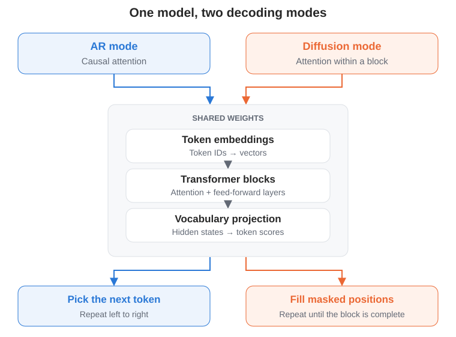
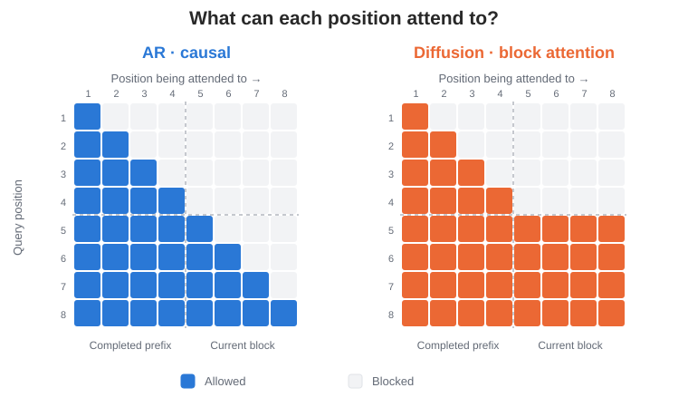
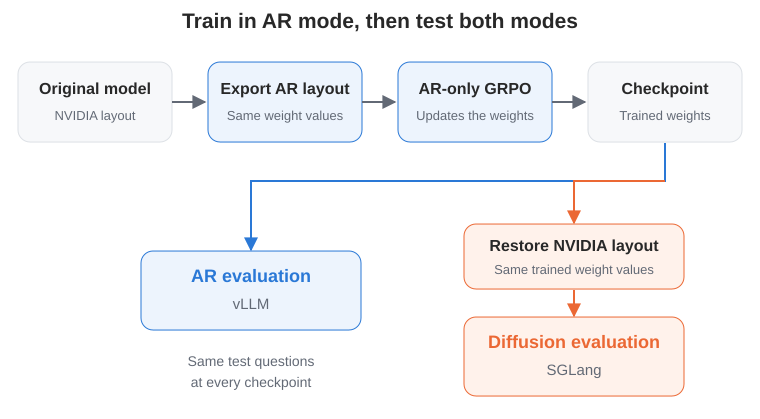

<!-- Chart data comes from data/*.csv, exported from the evaluation outputs and training log. -->

```{python}
#| label: setup
import pandas as pd
import plotly.graph_objects as go
from plotly.subplots import make_subplots

modes = pd.read_csv("data/modes.csv")
train = pd.read_csv("data/train.csv")
train_eval = pd.read_csv("data/train_eval.csv")

# Bundle Plotly into the frozen output so charts also work without a CDN.
from IPython.display import HTML, display

_plotly_loaded = False


def show(fig):
    global _plotly_loaded
    display(HTML(fig.to_html(
        full_html=False, include_plotlyjs=not _plotly_loaded,
        config={"responsive": True, "displaylogo": False,
                "modeBarButtonsToRemove": ["sendDataToCloud", "shareChart", "select2d", "lasso2d"]},
    )))
    _plotly_loaded = True

AR, DIFF = "#2a78d6", "#eb6834"
NAMES = {"ar": "AR mode", "diff": "Diffusion mode"}
COLORS = {"ar": AR, "diff": DIFF}


def style(fig, title, x_title, y_title, height=440):
    fig.update_layout(
        template="plotly_white",
        title=dict(text=title, x=0.01, font=dict(size=15)),
        font=dict(size=12),
        legend=dict(orientation="h", yanchor="top", y=-0.2, x=0),
        margin=dict(t=70, b=60, l=55, r=20),
        height=height,
        hovermode="x unified",
    )
    fig.update_xaxes(title_text=x_title)
    fig.update_yaxes(title_text=y_title)
    return fig


def acc_by_step(task, title, y_title):
    fig = go.Figure()
    steps = sorted(modes[modes.task == task].step.unique())
    for m in ("ar", "diff"):
        d = modes[(modes.task == task) & (modes["mode"] == m)].sort_values("step")
        fig.add_trace(go.Bar(
            x=d.step.astype(str).tolist(), y=d.acc * 100, name=NAMES[m],
            marker_color=COLORS[m],
            text=[f"{value:.1f}" for value in d.acc * 100], textposition="auto",
            error_y=dict(type="data", array=d.se * 100, thickness=1, width=3, color="#555"),
            hovertemplate="Step %{x}<br>%{y:.1f}% correct<extra>%{fullData.name}</extra>",
        ))
    style(fig, title, "training step", y_title, height=470)
    fig.update_layout(barmode="group", bargap=0.23, bargroupgap=0.06,
                      uniformtext=dict(minsize=10, mode="hide"))
    fig.update_xaxes(type="category", categoryorder="array", categoryarray=[str(step) for step in steps],
                     tickvals=[str(step) for step in steps],
                     ticktext=["0<br>(base)" if step == 0 else str(step) for step in steps])
    fig.update_yaxes(range=[0, 100], tick0=0, dtick=20)
    return fig

```

First things first, this new model by NVIDIA, [Nemotron-Labs-Diffusion-3B](https://huggingface.co/nvidia/Nemotron-Labs-Diffusion-3B),
blew my mind. It can generate text in two ways: one token at a time, like a regular language model
(autoregressive, or AR mode), and several tokens at once (diffusion mode). Both modes use the same model weights.

The speed is what excites me. But I haven't come across a post-training recipe for diffusion transformers that
feels mainstream yet. How do I take one of these fast models and make it better at a task?

We already have recipes for post-training autoregressive models. **What if I
post-train this model in AR mode, then switch it back to diffusion? Does any of that improvement carry over?**

If it does, that would be insanely valuable: I could use a familiar training setup to improve the model, then
use its faster diffusion mode to generate answers. That could be extremely useful in production applications,
where I want a model that's good at the task and responds quickly. Of course, sharing weights doesn't guarantee
that the gains transfer.

## Experiment design

For this run, I use reinforcement learning (RL) to train **only the AR mode**. I save checkpoints along the way
and try each one in both modes. Step 0 is the original model, before any training.

I wanted problems with room to improve and answers I could check automatically.

The [tech report](https://d1qx31qr3h6wln.cloudfront.net/publications/Nemotron_Diffusion_Tech_Report.pdf) reports
87.9% on GSM8K in AR mode and 88.4% in diffusion mode for the 3B instruct model. There's less room to improve
there, so I kept GSM8K as a check and looked for harder problems to train on.

For [MATH](https://huggingface.co/datasets/DigitalLearningGmbH/MATH-lighteval), I tried 300 problems each
from Levels 3, 4 and 5 of the test set in AR mode:

| MATH level | AR accuracy |
|---|---|
| Level 3 | 84.3% |
| Level 4 | 75.7% |
| Level 5 | 59.3% |

Level 5 it is. Diffusion mode on the same 300 problems got 56.3% using NVIDIA's HF implementation. Those probe
scores helped me pick the task; the larger checkpoint sweep below uses SGLang for diffusion.

Here's the training and eval setup:

| Part of the experiment | Setup |
|---|---|
| Model | Nemotron-Labs-Diffusion-3B |
| Training | AR-only RL on [MATH](https://huggingface.co/datasets/DigitalLearningGmbH/MATH-lighteval) train Levels 4 and 5: 3,994 problems |
| Testing on MATH | 500 [MATH](https://huggingface.co/datasets/DigitalLearningGmbH/MATH-lighteval) Level-5 problems from the test split |
| Checking GSM8K | 200 [GSM8K](https://huggingface.co/datasets/openai/gsm8k) test questions, outside the training dataset |
| Checkpoints evaluated | Original model, then steps 25, 50, 75, 100, 125 and 150 |

I didn't train on GSM8K. I keep those questions around to check whether training on MATH also changes how the
model handles another set of problems, especially whether it makes those answers worse.

Each checkpoint gets the same test questions, with greedy decoding and one answer per question. I count how
many answers are right. For MATH, `math-verify` parses the prediction and checks it against the gold solution.
For GSM8K, I check the last number in the last `<answer>` tag, falling back to the last number in the output
if the tag is missing.

The instructions go in a single user message; I don't add a custom system prompt. For MATH, I use the same
prompt during training and evaluation in both modes:

```text
{problem}

Think step by step, then put the final answer in \boxed{}.
```

For the GSM8K check:

```text
{question}

Think step by step, then give the final number inside <answer> </answer> tags.
```

Both use the model's chat template with `enable_thinking=False`.

I shuffle the MATH test questions with seed 1234 before selecting them; GSM8K keeps its original test order.
The pinned revisions are `0530c786` for MATH, `740312ad` for GSM8K and `0d51902d` for the model.
AR runs through vLLM, diffusion through SGLang. Each mode keeps the same engine and settings across checkpoints.

## Training setup

Before getting to GRPO, it helps to unpack how this model can do both jobs. In the
[paper](https://arxiv.org/pdf/2607.05722), NVIDIA trains a shared transformer with two objectives: predict the
next token from the tokens before it, and recover missing tokens inside a block. The same weights learn both.

{#fig-shared-model fig-alt="AR and diffusion use one shared model, with different attention patterns and decoding procedures."}

The attention mask controls which tokens can see each other:

- **AR mode:** causal attention limits each position to itself and earlier positions; the model predicts the
  next token from that prefix. Generation proceeds left to right.
- **Diffusion mode:** positions inside the current block can attend to each other and the completed prefix.
  The model fills masked positions over several passes, committing confident predictions. Blocks still finish
  in order; the whole answer isn't generated at once. I use 32-token blocks here.

{#fig-attention-masks fig-alt="Side-by-side attention matrices compare a causal mask with bidirectional attention inside the current diffusion block."}

The paper calls this a *tri-mode* model because it also supports self-speculation: diffusion drafts tokens and
AR verifies them. This experiment uses the two modes separately.

For the 3B checkpoint, the
[implementation](https://huggingface.co/nvidia/Nemotron-Labs-Diffusion-3B/blob/0d51902da1f8869f83413ce642fab402fa5641e0/modeling_nemotron_labs_diffusion.py)
wraps a Ministral3 transformer and an output layer that turns its hidden states into scores over the vocabulary.
That transformer is stored under `encoder`, and the output layer under `diffusion_head`. Both are used by the
AR path too, despite those names.

Now the practical problem: I'm using TRL's GRPO trainer with vLLM to generate the training answers. I need those
tools to load the checkpoint as a causal language model. NVIDIA ships a custom model class with its own
AR and diffusion generation methods, so I can't just point my usual training setup at it and assume it'll work.

But I only need the AR path for training. Since that path uses the Ministral3 backbone, I can save the weights
in the layout expected by `Ministral3ForCausalLM`, which my training stack can load.

{#fig-training-workflow fig-alt="Original weights are exported for AR-only GRPO. Each trained checkpoint is evaluated in AR mode and restored to NVIDIA layout for diffusion evaluation."}

::: {.callout-note title="What the conversion changes"}

The conversion renames the weight keys and writes a matching Ministral3 model config:

| NVIDIA checkpoint | AR checkpoint used by the trainer |
|---|---|
| `encoder.*` | `model.*` |
| `diffusion_head.*` | `lm_head.*` |

The weight values and tokenizer stay the same. This export gives the trainer the AR view of the model;
it doesn't provide diffusion generation. To evaluate a trained checkpoint in diffusion mode, I reverse the
names and load the updated weights with NVIDIA's original config and model code.

:::

Before training, I checked the original AR path against the converted model on the same prompt. The largest
logit difference was 0.0, and greedy decoding produced the same tokens. That check gave me confidence to use
the converted checkpoint for the run. GRPO then updates those shared weights through AR answers; afterward,
I load them back into the original model to see what happened to diffusion.

The RL itself is plain GRPO in TRL, with vLLM generating the rollouts:

- 64 problems per step, 8 answers each, so 512 rollouts per step
- learning rate 1e-6, no KL penalty, temperature 1.0, up to 2,048 tokens per answer
- reward is 1 for a correct answer, 0 otherwise
- a checkpoint every 25 steps

```bash
VLLM_USE_FLASHINFER_SAMPLER=0 uv run accelerate launch --config_file configs/fsdp8.yaml -m dar.train_grpo \
  --task math --run-name math-ar-grpo \
  --hypothesis "RL in AR mode also raises diffusion-mode accuracy on the same task" --vllm-mem 0.4
```

## The training run

Training took about 34 seconds per step. I planned 200 steps, but the trainer's own check (AR mode, 128 test problems, one sampled answer each) went flat
around step 100, so I stopped it after 164 logged training steps. The last checkpoint is step 150.

```{python}
#| label: fig-train
#| fig-cap: "Top: mean reward on the training rollouts (10-step rolling mean), which is the share of the 512 sampled answers per step that were right. Bottom: mean answer length in tokens. Both come from the training batch, not the test set."
fig = make_subplots(rows=2, cols=1, shared_xaxes=True, vertical_spacing=0.08,
                    subplot_titles=("training reward (share of rollouts correct)", "mean answer length (tokens)"))
fig.add_trace(go.Scatter(x=train.step, y=train.reward.rolling(10, min_periods=1).mean(), name="reward",
                         line=dict(color=AR, width=2), hovertemplate="%{y:.3f}"), row=1, col=1)
fig.add_trace(go.Scatter(x=train.step, y=train.mean_length.rolling(10, min_periods=1).mean(), name="answer length",
                         line=dict(color=AR, width=2), hovertemplate="%{y:.0f}"), row=2, col=1)
style(fig, "AR-mode GRPO on MATH Levels 4-5", None, None, height=560)
fig.update_xaxes(title_text="training step", row=2, col=1)
fig.update_layout(showlegend=False)
show(fig)
```

The reward goes from about 0.62 over the first 10 steps to about 0.74 after step 100. The answers also get a lot
longer, from about 735 tokens to about 1,100. By steps 51 to 100, about 21% of the rollouts were hitting the 2,048-token limit.

```{python}
#| label: fig-trainer-eval
#| fig-cap: "Trainer-side AR evaluation: 128 test problems, one sampled answer each. This is a separate evaluation from the 500-problem greedy checkpoint sweep below."
fig = go.Figure(go.Scatter(
    x=train_eval.step, y=train_eval.eval_acc_ar_sampled_128 * 100,
    mode="lines+markers", name="AR (sampled, n=128)",
    line=dict(color=AR, width=2), marker=dict(size=8),
    hovertemplate="Step %{x}<br>%{y:.1f}%<extra>%{fullData.name}</extra>",
))
fig.update_xaxes(tickvals=train_eval.step.tolist())
show(style(fig, "The trainer's sampled AR check", "training step", "accuracy (%)"))
```

## Results

```{python}
#| label: fig-math
#| fig-cap: "MATH Level 5, 500 test problems, greedy, one answer per problem. Step 0 is the base model. Error bars are ±1 standard error (about ±2.2 points). AR in vLLM, diffusion in SGLang (FastDiffuser, block 32, threshold 0.9)."
show(acc_by_step("math-l5", "MATH Level 5: AR vs diffusion", "accuracy (%)"))
```

And... it moves. Diffusion goes from 51.8% to between 55.2% and 59.0%, depending on the checkpoint.
AR goes from 59.2% to between 63.0% and 66.8%.

Across the six checkpoints, AR gains 5.6 points on average and diffusion gains 5.3. Almost the same gain,
even though diffusion never saw a masked block during training.

I also checked which of the 500 problems each checkpoint fixed or broke compared with step 0, using a McNemar test. For diffusion, the change from step 0 is significant at p < 0.05 at steps 25, 75, 125 and
150 (p = 0.007, 0.014, 0.002, 0.031). At steps 50 and 100 it isn't (p = 0.09 and 0.16). AR is significant at every
checkpoint except step 75 (p = 0.08). Those are unadjusted p-values across six checkpoint comparisons per mode. These checkpoints share a training run and test questions, so they aren't independent experiments.

The gap doesn't close, though. Diffusion is 7.4 points behind AR at step 0 and 8.0 behind at step 150.

### GSM8K

```{python}
#| label: fig-gsm8k
#| fig-cap: "GSM8K, 200 test questions, greedy, one answer per problem. Step 0 is the base model. Error bars are ±1 standard error (about ±2.3 points). None of the changes from step 0 is significant at p < 0.05 (McNemar, per mode)."
show(acc_by_step("gsm8k", "GSM8K: AR vs diffusion", "accuracy (%)"))
```

On GSM8K, AR goes from 87.5% to between 88.0% and 91.5%, and diffusion from 86.5% to between 87.0% and 89.5%.
None of the changes from step 0 is statistically significant. I don't see a clear regression here, but 200 questions
can't rule out smaller changes or tell me what happens on other tasks.

## Running out of tokens

The longer answers run into the token limit at eval time too.

At step 0, 26 AR answers and 22 diffusion answers ran out of room. From step 50 on it's between 93 and 138 in each mode,
so a fifth to a quarter of all answers get cut off before they reach a `\boxed{}`. I looked at the cut-off diffusion
answers from step 75, and they aren't loops, they're just long, careful markdown solutions that run out of tokens.

RL is partly fighting its own length here: TRL drops truncated completions from the loss.

I also caught a mismatch while writing this: the AR eval in vLLM had a 2,048-token *context*, so the answer
budget was 2,048 minus the prompt (45 to 1,087 tokens). Diffusion got 2,048 new tokens. Longer answers after
training mean that mismatch can affect the measured gains too. I've fixed the budget setup for the next run.

I'd like to try this with a bigger answer budget and more seeds. This was one run of one 3B model, and I used
the test split to pick a difficulty level and monitor training. Next time, those decisions need a separate set.

<!-- TODO: next experiments (to be decided). Candidates: rerun the sweep with a 4,096-token budget; decoding sweep
(threshold / block size) on base vs step 125; LinearSpec acceptance length as a direct "do the modes agree" measure;
RL in diffusion mode and measure AR (the mirror experiment). -->


::: {.callout-note collapse="true" title="Eval settings"}

For the first diffusion numbers I used NVIDIA's HF `generate()` with block size 32 and confidence threshold 0.9,
which is what the model card shows. It works, but it decodes one problem at a time. On 300 Level-5 problems it ran at
about **77 tokens/s per GPU**. At that rate, evaluating 7 checkpoints × 700 problems would take too long.

At the time of this run, the vLLM diffusion path I looked at supported DiffusionGemma, and each model brought
its own sampler, so using this model there would have needed a port. NVIDIA's own serving code is an SGLang PR,
[sgl-project/sglang#25803](https://github.com/sgl-project/sglang/pull/25803), which adds this model with `FastDiffuser`
(plain diffusion mode) plus CUDA graphs and batching. I built that branch in its own environment, since it wants
torch 2.11, with the same settings as the HF run: 32-token blocks, threshold 0.9, a causal pass to seed each block.

Getting it to start on this box took three fixes, all on the environment side. There's no CUDA toolkit on the node, so
I pointed `CUDA_HOME` at the one that ships in the venv. FlashInfer tried to compile its kernels and failed, so I
installed its prebuilt kernels the same way the PR's Dockerfile does. And pip had pulled a CUDA 13.4 compiler next to
a 13.0 runtime, so I pinned the compiler packages back to 13.0.

After that: about **1,340 tokens/s per GPU**. 300 problems in 97 seconds.

But the accuracy didn't match. On the same 300 problems SGLang got 52.3%, HF got 56.3%. Only 27 of the 300 answers
were word for word the same, and the rest split after about 400 characters (the median), which is consistent with greedy
decoding diverging after small numerical differences between engines. I did not isolate the cause. On the problems where they disagree, HF alone was
right on 32 and SGLang alone on 20. That's a McNemar p of about 0.10, so the gap could be noise, but I can't call it
zero either. So the rule from here on: every checkpoint goes through SGLang, and I only compare SGLang numbers with
SGLang numbers.

:::

## Data behind the charts

The CSVs used in the charts are here:
[checkpoint evaluations](data/modes.csv), [training metrics](data/train.csv),
[trainer evaluations](data/train_eval.csv), and [task and engine probes](data/probes.csv).
The paired-test p-values are recorded in the checkpoint export; the per-problem outputs are not included here.
